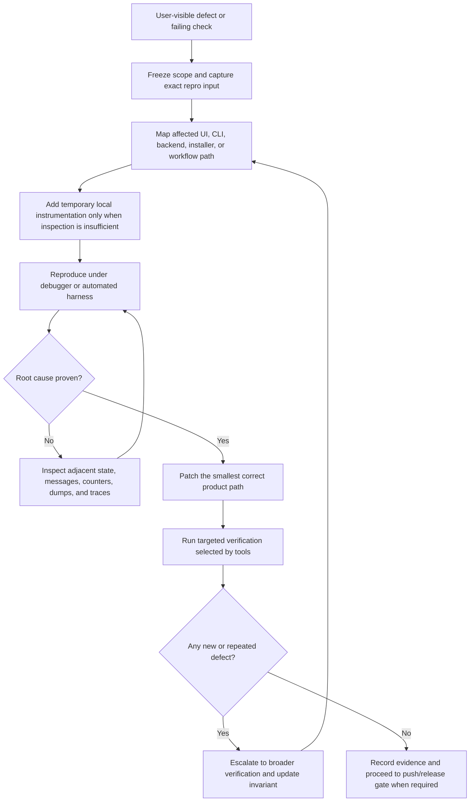

# Debugging Strategy

This document defines investigation of native Windows C++, GUI, tool and GPU
failures. Use it with change-aware verification; debugging evidence and release
qualification answer different questions.

## Investigation Contract

Before editing, establish the observable invariant, affected consumer and
source/binary/input identities. Separate observations from hypotheses. A local
note is enough; do not create another tracking system.

1. **Locate the first divergence.** Trace input and state transitions through the
   public entry point. Distinguish invalid expectations, harness failures,
   instrumentation limits and production defects. For intermittent failures,
   retain the first failure and inspect ordering, shared state and completion.
2. **Choose a discriminating experiment.** State what would reject the hypothesis.
   Vary one relevant condition, bound execution and preserve raw failures.
   Another unchanged retry is not an explanation.
3. **Prove the boundary.** Follow [oracle selection](code-coverage.md#oracle-selection).
   Check success, rejection, preserved caller state, released resources and valid
   reuse. Exercise the public consumer when routing or ownership affects results.
4. **Repair and challenge.** Fix the first violated production contract, inspect
   siblings and demonstrate regression sensitivity where practical. Avoiding a
   failing schedule or input alone does not establish a repair.
5. **Qualify the conclusion.** Run selected direct consumers; retain pending
   broader checks for final qualification. Record cause, evidence and limits.
   A later pass does not establish the cause of an unreproduced report.

### External Failure Controls

Prefer real OS rejection, independently framed corrupt input and bounded stream
failures. If those cannot reach the contract, use a narrow per-instance adapter
around the external dependency. Preserve production API semantics and keep
successful acquisitions real where feasible. Assert cleanup and successful reuse,
not just a mock call count. Do not patch process imports, add mutable global
hooks, exhaust host resources or expose a public bypass solely for testability.

Match injected failures to the actual runtime and exception guarantee. A Debug
library allocation inside a nonthrowing operation is not automatically a Release
defect. Consult [exception safety](https://learn.microsoft.com/en-us/cpp/cpp/how-to-design-for-exception-safety)
and [RAII ownership](https://isocpp.github.io/CppCoreGuidelines/CppCoreGuidelines#r1-manage-resources-automatically-using-resource-handles-and-raii-resource-acquisition-is-initialization),
then qualify the production configuration needed to support the conclusion.

## Research Basis And Tool Limits

Read primary contracts for the version and platform actually used. These sources
guide method selection; reading them does not qualify the product.

| Source | Application in FlitzZip |
| --- | --- |
| [Google review guidance](https://google.github.io/eng-practices/review/reviewer/looking-for.html#tests) | Challenge whether assertions detect broken behavior; review tests as maintained code |
| [LLVM regression guidance](https://llvm.org/docs/TestingGuide.html) | Reduce real failures to focused regression inputs |
| [libFuzzer](https://llvm.org/docs/LibFuzzer.html#fuzz-target) and [OSS-Fuzz integration](https://google.github.io/oss-fuzz/advanced-topics/ideal-integration/) | Keep parser targets bounded and repeatable; replay retained inputs without requiring a new service |
| [MSVC AddressSanitizer](https://learn.microsoft.com/en-us/cpp/sanitizers/asan) and [Application Verifier](https://learn.microsoft.com/en-us/windows-hardware/drivers/devtest/application-verifier) | Select supported memory/API diagnostics; instrument only owned test processes |
| [ThreadSanitizer platforms](https://clang.llvm.org/docs/ThreadSanitizer.html#supported-platforms) | Do not promise native Windows race coverage from an unsupported tool |
| [Google flaky-test analysis](https://testing.googleblog.com/2016/05/flaky-tests-at-google-and-how-we.html) | Retries and quarantine can conceal genuine defects; they do not establish a repair |
| [HIP errors](https://rocmdocs.amd.com/projects/HIP/en/latest/how-to/hip_runtime_api/error_handling.html) and [asynchronous execution](https://rocm.docs.amd.com/projects/HIP/en/latest/how-to/hip_runtime_api/asynchronous.html) | Separate API/launch errors from completion and keep owners until work finishes; logging examples are not a recovery policy |

Older reports describe their own systems, not FlitzZip failure rates. Keep raw
research and diagnostics in local evidence; update rules when evidence changes
engineering decisions.

## Principles

- Reproduce first, then patch. A defect is not understood until the failing
  precondition, state transition, and observable result are known.
- Trace the complete path from input event to product outcome. For GUI defects,
  that means hit test, focus state, UI state mutation, worker launch, backend
  call, progress publication, status/history update, and repaint.
- Use the verification planner for the complete change scope. Diagnose a failed
  focused check before widening coverage; select broader checks when evidence
  shows cross-component impact. Preserve all checks required by that scope.
- Prefer evidence over intuition. Record the command, input data, expected
  behavior, actual behavior, and artifact path for every confirmed defect.
- Fix root causes. Do not hide findings behind broad exclusions, skipped tests,
  or cosmetic status changes.
- Keep hardware claims explicit. GPU work requires direct telemetry from the AMD
  HIP path; CPU fallback does not count as GPU acceleration evidence.

## Investigation Flow

## GUI Bug Sweep Matrix

Each GUI bug-hunting pass must inspect these paths when the affected area is
near them:

| Area | Required checks |
| --- | --- |
| Queue | Add files, add folders, native file drop, OLE file drop, checkbox toggle, header toggle, column resize, overflow scroll, fixed header, hover tooltip, keyboard focus, Space/Enter activation, empty state, large item counts. |
| Compress | Archive name, destination default, format dropdown, compression level, method, block size, toggles, Start, progress bar, status bar, average throughput, time remaining, output existence, standards compatibility. |
| Extract | Archive field, destination default, archive format display, overwrite policy, integrity/security toggles, Start, progress bar, safe output publication, unsupported archive failure. |
| Security | Empty queue state, selected archive state, Defender opt-in, hash opt-in, Verify, progress bar, status/history/log behavior. |
| System | HIP status, CPU total/dedicated counters, RAM total/dedicated counters, I/O counters, total GPU utilization graph, VRAM total/dedicated rows, refresh interval, axis labels, repaint stability. |
| Settings | Load, draft changes, tab-leave revert, Apply persistence, Restore Defaults, every toggle, every dropdown, log retention pruning. |
| History | Filtering, clear action, row rendering, long text, keyboard traversal, overflow wheel/track/drag endpoints. |
| About | Single-source logo rendering, tagline consistency, author/version spacing, keyboard behavior. |

## Native Debugging Checklist

Use the narrowest tool that proves or rejects the hypothesis:

- Breakpoint or tracepoint: prove command routing, state mutation, and worker
  launch without changing product behavior.
- Conditional breakpoint: stop only on specific page, row, format, archive path,
  status text, HRESULT, exception, or worker state.
- Data breakpoint: find unexpected writes to selection, queue enable flags,
  destination paths, progress state, or GPU telemetry fields.
- Message inspection: verify `WM_MOUSEMOVE`, `WM_MOUSEWHEEL`, `WM_DROPFILES`,
  OLE drag/drop, `WM_KEYDOWN`, timers, posted repaint messages, and focus
  behavior.
- Crash dump: preserve postmortem state for non-reproducible termination.
- Sanitizer build: detect memory safety defects in parser, codec, and utility
  code.
- Runtime verifier: detect invalid handles, heap misuse, COM lifetime mistakes,
  lock-order hazards, and invalid API usage.
- Event trace: isolate UI stalls, paint storms, timer drift, disk activity,
  CPU bottlenecks, GPU inactivity, or worker starvation.
- Static analysis: find unsafe lifetime, non-local pointer storage, oversized
  functions, long switches, unchecked return values, and resource leaks.

## Evidence Requirements

Every completed defect fix must leave enough evidence for a later agent to
understand the result:

- Reproduction path or reason the defect could not be reproduced locally.
- Root cause in product terms, not just a code location.
- Exact files changed.
- Targeted local checks run and their result.
- Any skipped check with a concrete reason and follow-up condition.
- Whether final GitHub workflow wait, release replacement, or post-push audit
  is required by the task.

## Regression Rules

Operation-summary smoke verifies enabled success, an unapplied enable over an
applied disabled preference, and an ordinary locked-output failure. It checks
the new job's success/failure log, completion events, the active page, preserved
output bytes, and rendered result captures. Failure presentation must clear
stale History filters. Native tests cover job-local primary-row selection,
batch failures, empty results, auxiliary checks, and History clears before or
after completion without selecting a stale row in the next job.

Compact GUI checks must preserve native font sizes and validate actual client
dimensions. Screenshot helpers accept an explicit expected design size while
retaining the default 1200-by-760-DIP assertion. `gui_smoke.ps1 -CompactOnly`
is a focused diagnostic, not a replacement for the default all-page smoke.
The compact Format test must select and persist the last option using wheel,
arrow-band, and keyboard input. A rendered menu alone is not success.

Work-area tests query the real monitor and client/frame bounds. They exercise
startup plus work-area, display-change, and completed-move notifications by
resizing only the owned test window, never altering host displays. Native
geometry tests separately cover negative monitor coordinates and multiple DPI
values. Compact Licenses checks wait for newly appended open/close completion
events rather than guessing when the deferred button timer has fired; they
also verify both selected tabs and the restored About page. Compact overwrite
checks cancel through the actual button and confirm the existing destination
is unchanged. Geometry, command completion, and rendered pixels are distinct
evidence and must not be substituted for each other.

Do not mix posted mouse clicks and immediately sent keyboard messages when
the test requires ordered input. Sent messages can overtake queued clicks.
Compact tests use timeout-bounded synchronous clicks, then assert newly
appended command results and persisted settings. Arbitrary sleeps are not the
ordering guarantee. The API contracts are documented by Microsoft for
[SendMessageTimeoutW](https://learn.microsoft.com/en-us/windows/win32/api/winuser/nf-winuser-sendmessagetimeoutw)
and native text measurement through
[DrawTextW](https://learn.microsoft.com/en-us/windows/win32/api/winuser/nf-winuser-drawtextw).

GPU/RAM detail clipping at compact widths came from a fixed 42-DIP text region
despite additional wrapped lines. Tests now measure the native detail font
across eight DPI values with large totals and unavailable counters, checking
that text fits and leaves a positive, separated graph plot.

History scrolling must use `history_layout(...).table`, as rendering, keyboard
navigation, and click hit testing do. The former wheel/drag paths independently
reserved 96 DIPs for details instead of the layout's 118 DIPs. At the default
window size this counted an extra visible row and prevented pointer scrolling
from reaching the last row. The GUI smoke reproduces overflow using 20 real
Settings saves in isolated test storage, then verifies both painted scrollbar
endpoints for wheel input, track clicks, and thumb dragging. The regression
failed against the pre-fix binary at the wheel's bottom endpoint. This check
does not certify responsive window sizing or untested display configurations.

- Never add a new UI feature without retesting the existing interactions in the
  same page.
- Never change a visual layer without checking text clipping, hit testing,
  keyboard focus, hover state, and repaint behavior.
- Never change archive output paths without testing explicit destination and
  default destination.
- Never change GPU telemetry without proving whether the value represents total
  system usage, process usage, VRAM usage, or HIP work.
- Never change benchmarks or performance counters in a way that writes large
  generated workloads to storage.
