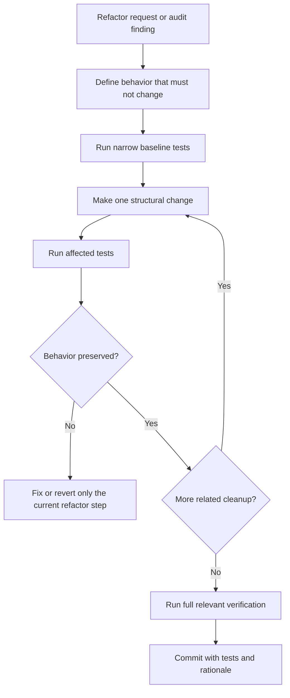

# Refactoring Governance

This document defines how FlitzZip refactoring is planned, triggered, executed,
and verified without changing product behavior accidentally.

## Research And Adoption

| Primary guidance | Adopted decision |
| --- | --- |
| [Google small changes](https://google.github.io/eng-practices/review/developer/small-cls.html) and [review standard](https://google.github.io/eng-practices/review/reviewer/standard.html) | Keep coherent changes reviewable and their regressions together; prioritize demonstrated correctness and maintainability |
| [C++ Core Guidelines](https://isocpp.github.io/CppCoreGuidelines/CppCoreGuidelines) and [Microsoft resource ownership](https://learn.microsoft.com/en-us/cpp/cpp/object-lifetime-and-resource-management-modern-cpp) | Establish ownership immediately, keep invariants explicit and review exception paths before structural movement |
| [NIST SSDF](https://csrc.nist.gov/pubs/sp/800/218/final) and [CISA Secure by Design](https://www.cisa.gov/securebydesign) | Treat security and recurrence prevention as lifecycle responsibilities |
| [GitHub Actions security](https://docs.github.com/en/actions/security-for-github-actions/security-guides/security-hardening-for-github-actions) | Preserve least privilege, pinned dependencies and trust boundaries during workflow optimization |
| [SLSA build track](https://slsa.dev/spec/v1.2/build-track-basics) and [artifact verification](https://docs.github.com/en/actions/concepts/security/artifact-attestations) | Verify artifact identity and provenance; attestation generation alone does not prove trust or product correctness |
| [Reproducible-build definition](https://reproducible-builds.org/docs/definition/) | Claim reproducibility only after comparing the specified outputs under the recorded source, environment and recipe |
| [SPDX license information](https://spdx.dev/learn/handling-license-info/) and [OpenChain compliance](https://openchainproject.org/license-compliance) | Preserve notices, exact license choices and distribution obligations when moving or replacing components |
| [Google README guidance](https://google.github.io/styleguide/docguide/READMEs.html), [documentation best practices](https://google.github.io/styleguide/docguide/best_practices.html) and [Diataxis](https://diataxis.fr/) | Keep the product entry point short, maintain task-focused guides and reference material, and give each fact one canonical home |
| [Zstandard contributing](https://github.com/facebook/zstd/blob/dev/CONTRIBUTING.md), [libarchive contributing](https://github.com/libarchive/libarchive/blob/master/CONTRIBUTING.md) and [LLVM policy](https://llvm.org/docs/DeveloperPolicy.html) | Keep changes coherent, retain small reproducers, require behavior regressions and distinguish development checks from release qualification |
| [PowerToys documentation](https://github.com/microsoft/PowerToys) and [CI](https://github.com/microsoft/PowerToys/blob/main/.pipelines/v2/ci.yml) | Separate user and developer entry points; select affected UI checks while preserving release packaging obligations. Adopt relevant design principles without importing another project's contribution or service policy |

Consult the [NIST publication status](https://csrc.nist.gov/projects/ssdf/publications)
before treating a revision as final. These references inform engineering decisions, not a claim of certification
or complete conformance. Recheck changed external contracts when adopting them;
do not recrawl unchanged background documents during each implementation batch.

The common rule is that refactoring changes structure while preserving behavior.
For FlitzZip, that means tests, benchmark baselines, and security gates are part
of the refactor itself, not a cleanup step after the fact.

## Modernization Baseline

Modernization work must improve the codebase through enforceable properties:
clear ownership, bounded resources, simpler dependency direction, smaller
functions, explicit contracts, stronger tests, and more accurate telemetry.
Do not perform vague repo-wide rewrites. A modernization commit must state the
behavior preserved, the invariant improved, and the verification that proved it.

## Trigger Policy

Refactoring may start in two ways:

- User-requested: a maintainer explicitly asks for cleanup, architecture work,
  readability work, or performance-neutral restructuring.
- Audit-triggered: `tools\refactor_audit.ps1` reports files or functions that
  cross the repo thresholds and the agent or maintainer decides the change is
  worth the risk.

Automatic audit-triggered refactoring must not silently land broad changes.
The automation produces findings and a plan; code edits still need tests and a
normal reviewable commit.

Changed code is held to a stricter gate than the historical backlog. The
repository still contains known large legacy surfaces, especially the native
Win32 UI shell, so the full audit remains a planning tool. New or modified
functions must pass the changed-code gate before push:

```powershell
tools\refactor_audit.ps1 -ChangedOnly -CheckContracts -MaxFunctionLines 120 -MaxComplexityMarkers 35 -FailOnFindings
```

This gate is intentionally wired into `tools\security_scan.ps1` so large or
poorly documented functions are caught locally before CodeQL reports them after
push. Do not bypass it with exclusions; split the changed function or add the
required function contract.

## Workflow



## Refactoring Rules

- Keep functional changes separate from structural cleanup unless one cannot be
  tested without the other.
- Prefer smaller commits and smaller pull requests.
- Preserve public CLI output unless the change explicitly updates a documented
  contract.
- Preserve archive compatibility, path-safety behavior, Defender opt-in
  behavior, and AMD HIP required-GPU failure behavior.
- Measure performance before and after when touching hot paths, worker
  allocation, memory buffers, or GPU codec code.
- Do not replace clear code with an abstraction unless it removes real
  duplication, narrows ownership, or improves testability.
- Do not chase novelty for its own sake. Prefer established C++20 idioms and
  repo-local architecture over experimental language/library features unless
  they remove a concrete risk and are supported by the Windows MSVC/HIP toolchain.
- Keep hot-path refactors allocation-aware and concurrency-aware. New queues,
  buffers, threads, async work, GPU transfers, or caches need explicit limits and
  before/after performance evidence.
- Do not normalize third-party code under `third_party/upstream`; production
  dependency patches belong under the patched copy only.

## Required Gates

Use the change-aware planner and runner for the complete intended change range:

```powershell
tools\verification_plan.ps1 -IncludeUntracked
tools\verify_changes.ps1 -IncludeUntracked
```

The planner selects native builds, affected component or full runtime coverage,
scanner preflight, language lint and the changed-function gate. Preserve its
required checks; a documentation or tooling change does not independently
justify rebuilding native targets. Use the operating guide's checkpoint
procedure for ongoing development and final acceptance.

GUI changes additionally require the announced all-page smoke and visual
inspection defined by the operating guide. Performance changes use the
affected mode's existing measurement protocol: the
[paired benchmark controller](performance-block-size-validation.md) for numeric
efforts, or the [public-corpus controller](neutron-public-corpus-benchmark.md)
for Neutron. A numeric level-five sweep or autotuning run cannot qualify a
Neutron-only refactor. Keep before/after source and workload identities,
independent byte-exact readback, complete archive sizes and actual HIP telemetry.
All development benchmark payloads remain RAM-only. Filesystem correctness
smoke follows the guide's separate bounded-write contract.

## Audit Tool

Run:

```powershell
tools\refactor_audit.ps1
```

The default audit reports large files, large functions, and selected complexity
markers. It does not modify files. Add `-CheckContracts` when auditing function
contract comments; that heuristic is intentionally opt-in because lambdas and
test macros can produce false positives. Use `-FailOnFindings` only in a
deliberate quality gate after existing findings have been triaged.
